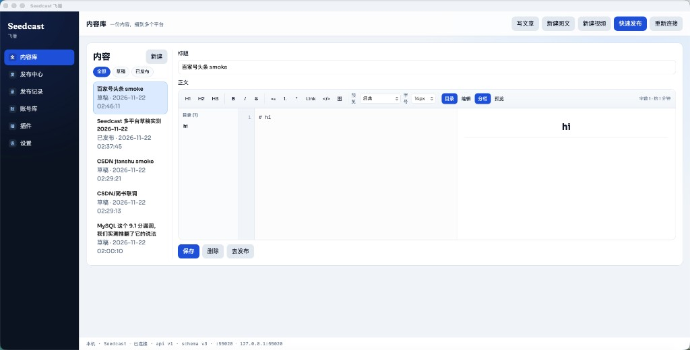
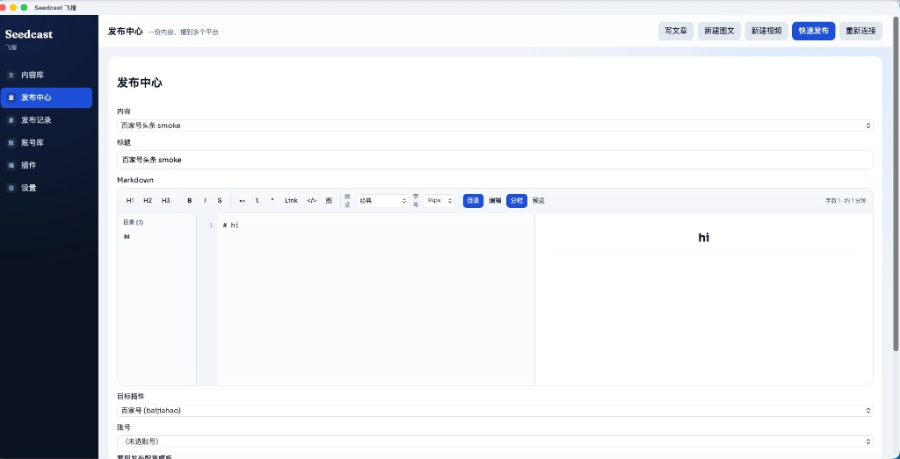
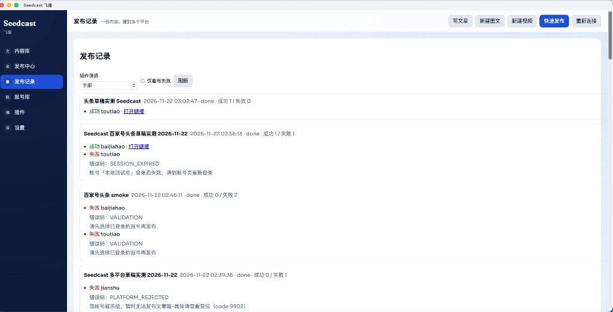
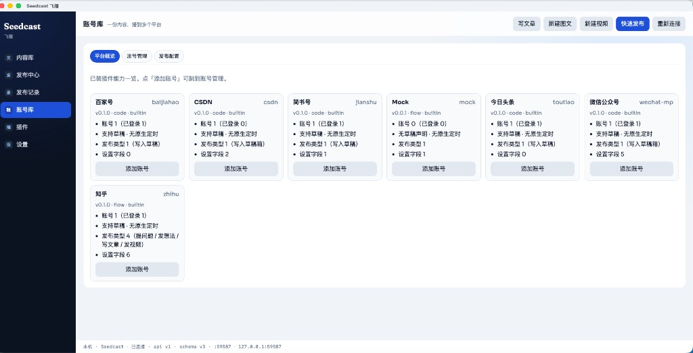
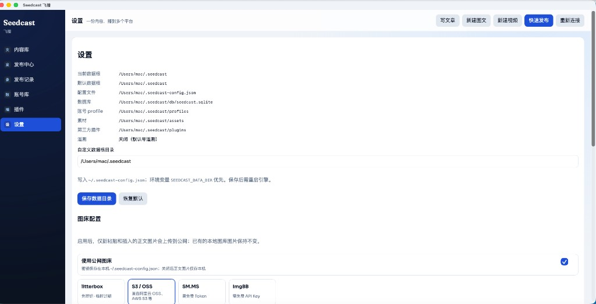

# Seedcast（飞播）

**开源、免费、纯本地的多平台内容发布桌面工具。**  
一份内容，像种子一样播撒到多个创作平台——告别反复登录、复制粘贴与改版排版。

[](./LICENSE)
[](https://github.com/owlteam990/seedcast)

> 数据只留在你的电脑上。账号会话、内容库、发布记录全部本地存储，**无云端账号托管、无内容上传到自有服务器**。

## 界面预览

左侧导航 + 右侧工作区：内容库、发布中心、发布记录、账号库、设置一应俱全。

### 内容库

Markdown 分栏编辑，草稿 / 已发布筛选，一键去发布。



### 发布中心

选内容、选平台与账号，一份稿件播到多个目标。



### 发布记录

每目标成败与错误码可读，成功可直达平台链接。



### 账号库

按插件管理平台能力与登录账号（公众号 / 知乎 / CSDN / 简书 / 百家号 / 头条等）。



### 设置

本机数据目录、公网图床（Litterbox / S3·OSS / SM.MS / ImgBB）均可配置。



---

## 为什么做 Seedcast

自媒体运营最费时的不是写作，而是「发一遍」：

- 每个平台打开一次后台、登录一次、粘贴一次、调一次封面与格式
- 商业群发工具往往把账号与内容放到云端，既贵又有合规顾虑
- 平台前端改版频繁，封闭工具一旦停更，整条分发链路就断

Seedcast 走的是 **本地桌面 + 开源插件** 路线：

| 对比维度 | Seedcast | 浏览器同步类扩展 | 商业桌面群发工具 |
|---|---|---|---|
| 形态 | 本地桌面应用（Tauri） | Chrome 扩展 | 多为闭源桌面 / 云端 |
| 数据 | `~/.seedcast/` 纯本地 | 浏览器本地 | 常含云端账号 / 任务 |
| 扩展方式 | 平台插件（声明式 + 代码适配器） | 扩展内置适配 | 厂商维护 |
| 许可证 | Apache-2.0，可商用 | 视项目而定 | 订阅 / 授权 |
| 目标 | 写作 → 多平台草稿 / 发布一条龙 | 页面文章一键同步草稿 | 全功能内容营销套件 |

灵感上分别参考了 [文章同步助手（WeChatSync）](https://www.wechatsync.com/#platforms) 的「开源免费、数据不出本机」与 [TurboPush](https://www.turbopush.top/) 的「桌面工作台 + 多平台一键触达」，并结合本仓库已落地的引擎、GUI 与平台插件写成当前能力说明。

---

## 核心能力（已实现）

### 内容创作与素材

- **内容库**：文章 / 图文 / 视频三类内容本地管理，支持新建、编辑、删除与列表检索
- **Markdown 编辑器**：分栏预览、行号、拖拽 / 粘贴插图；正文可走公网图床
- **图文 / 视频编排**：独立图文与视频组合界面，适配知乎等支持多内容类型的平台
- **文章导入（知乎）**：编辑器填写、导入公众号链接、导入 MD / 文档

### 账号与会话

- **账号挂在对应插件下**：在平台插件页添加、登录、检测，而不是孤立的全局账号墙
- **本机 Chrome + Playwright**：扫码 / 登录一次，会话写入独立 profile，长期复用
- **登录态检测**：Cookie / DOM / 平台接口多重校验；失效时明确提示重新登录
- **发布配置模板**：常用发布参数可存成模板，减少重复勾选

### 一键多平台发布

- **发布中心**：勾选多个已登录账号，一次提交，按队列串行执行（降低风控风险）
- **实时进度（SSE）**：每个目标平台的步骤、成败与结果链接可点开查看
- **草稿优先**：当前多数平台默认写入草稿箱，便于你在平台后台二次检查后再正式发表
- **发布记录**：历史任务可追溯，方便核对「发到了哪、成了没」

### 图床与资源

- **免费第三方图床**：如 ImgBB / Litterbox 等（可在设置中开关与测试）
- **S3 / OSS 兼容**：阿里云 OSS、AWS S3、MinIO 等；Endpoint / Bucket / 自定义域名 / Path Style
- **策略清晰**：启用图床后，**新粘贴 / 插入的正文图片**上传公网；本地图库旧图不受影响

### 插件化架构

- 新增平台 ≈ 一个插件目录（`manifest` + schema / selectors / flow 或代码适配器）
- 引擎侧统一：插件加载、会话池、串行队列、HTTP API、桌面 GUI
- 微信公众号走 **开放平台 AppID / AppSecret**；其余平台在无官方发布 API 时采用 Cookie + Web API 或页面 Flow（优先官方能力，其次社区协议参考，最后才自研自动化）

---

## 已支持平台

> 下表为仓库内**已接入**的官方插件（不含仅供联调的 `mock`）。能力以草稿 / 内容类型为准，会随平台改版持续迭代。

| 平台 | 插件 ID | 登录方式 | 发布方式 | 内容类型 | 说明 |
|---|---|---|---|---|---|
| 微信公众号 | `wechat-mp` | AppID / AppSecret | 开放接口写入草稿 | 文章 | 正式 API，稳定优先 |
| 知乎 | `zhihu` | 浏览器会话 | Flow 自动化 | 文章 / 图文 / 视频 | 提问题、发想法、写文章、发视频；支持公众号链接与文档导入 |
| CSDN | `csdn` | 浏览器会话 | Cookie + Web API | 文章 | 写入 Markdown 草稿 |
| 简书号 | `jianshu` | 浏览器会话 | Cookie + Web API | 文章 | 写入写作台草稿 |
| 百家号 | `baijiahao` | 浏览器会话 | Cookie + Web API | 文章 | 写入文章草稿 |
| 今日头条 | `toutiao` | 浏览器会话 | Cookie + Web API | 文章 | 写入创作台草稿 |

更多平台可通过插件贡献扩展（掘金、小红书、B 站专栏等欢迎 PR）。

---

## 三步开始使用

1. **安装运行**  
   开发期：克隆仓库，安装依赖后启动引擎与桌面端（见下方「开发」）。  
   发行期：使用 macOS / Windows 安装包（打包脚本已就绪，随 Release 提供）。

2. **登录平台**  
   打开对应插件 → 添加账号 → 在弹出的 Chrome 中完成扫码 / 登录 → 回到 Seedcast 检测会话。  
   微信公众号在插件内填写 AppID、AppSecret（及必要权限）。

3. **写作并发布**  
   在内容库用 Markdown 写好文章（或编排图文 / 视频）→ 发布中心勾选账号 → 一键提交 → 在发布记录查看回执，再到各平台草稿箱确认。

**环境依赖：** 本机已安装 Chrome（或兼容的 Chromium 内核浏览器）；桌面端发行包会自带引擎 sidecar，无需单独安装 Node。

---

## 安全与隐私

- 账号 Cookie / Profile、SQLite 内容库、素材文件均在本机目录 `~/.seedcast/`
- 引擎本地 HTTP 仅监听 `127.0.0.1`，带随机 Token，供 GUI 调用
- **不收集**你的平台密码；登录在你自己的 Chrome 窗口中完成
- 源码 Apache-2.0 开源，可自行审计构建链路

---

## 仓库结构

```
.
├── .github/workflows/        # CI：v* tag → mac dmg + win NSIS → Release
├── assets/screenshots/       # README 界面截图
├── code/                     # 可运行 monorepo（GitHub 主代码）
│   ├── apps/desktop          # Tauri 2 + React 桌面 GUI
│   ├── packages/
│   │   ├── engine            # Node 引擎：HTTP/SSE、会话、发布队列、适配器
│   │   ├── shared            # 共享类型与常量
│   │   └── plugin-sdk        # 插件契约
│   ├── plugins/              # 官方平台插件
│   ├── scripts/              # 如 macOS 打包脚本
│   └── RELEASE.md            # GitHub 发版操作手册
├── LICENSE                   # Apache License 2.0
└── README.md                 # 本说明
```

本地规划文档、changelog 等在开发机 `docs/` 目录维护，**不随仓库发布**。

---

## 开发

```bash
git clone https://github.com/owlteam990/seedcast.git
cd seedcast/code
pnpm install

# 类型检查 / 构建
pnpm --filter @seedcast/shared build
pnpm --filter @seedcast/engine typecheck

# 开发：引擎 + 桌面
pnpm dev:engine          # 另开终端
pnpm --filter @seedcast/app tauri:dev

# macOS 本机打包（示例）
pnpm build:mac
```

**要求：** Node 20+、pnpm 9+、本机 Chrome；打 macOS / Windows 包时还需对应平台的 Rust / Tauri 工具链。

### GitHub 自动发版

推送 `v*` tag 后，Actions 构建 macOS `.dmg` 与 Windows NSIS 并上传到 [Releases](https://github.com/owlteam990/seedcast/releases)：

```bash
# bump code/apps/desktop/src-tauri/tauri.conf.json 的 version 并 push main 后：
git tag v0.1.1
git push origin v0.1.1
```

步骤与注意事项见 [`code/RELEASE.md`](./code/RELEASE.md)。

更细的引擎 API、插件契约与打包说明见 `code/` 内各包 README 与 `plugins/*/NOTES.md`。

---

## 路线图（简要）

- [x] 本地引擎 + 桌面工作台（内容 / 发布 / 记录 / 插件 / 设置）
- [x] 微信公众号开放接口草稿
- [x] 知乎多类型发布与导入
- [x] CSDN / 简书 / 百家号 / 今日头条文章草稿
- [x] 公网图床（免费渠道 + S3/OSS）
- [x] MCP / CLI 编排（AI 代理经 stdio / 命令行调用同一本地 API）
- [x] CI 自动发版（`v*` tag → mac dmg + win NSIS → GitHub Release）
- [ ] 更多平台插件与社区贡献流程
- [ ] 正式自动更新与双端签名 / 公证

---

## 贡献

欢迎提交 Issue / PR：修平台改版、补新插件、改进 UI 与文档均可。  
贡献插件时请遵循「**官方 API → 社区现成方案 → 自研自动化**」的优先级，并在插件 `NOTES.md` 写清鉴权与实测结论。

---

## 许可证

本项目以 [Apache License 2.0](./LICENSE) 发布：免费开源，**允许商用**，需保留版权与变更声明。

---

## 致谢

- [WeChatSync / 文章同步助手](https://www.wechatsync.com/) — 开源多平台同步与本地数据理念
- [TurboPush](https://www.turbopush.top/) — 桌面多平台发布工作台体验参考
- 以及 Playwright、Tauri、各平台创作者生态的贡献者们

---

**Seedcast · 飞播** — 写一次，播多方。
